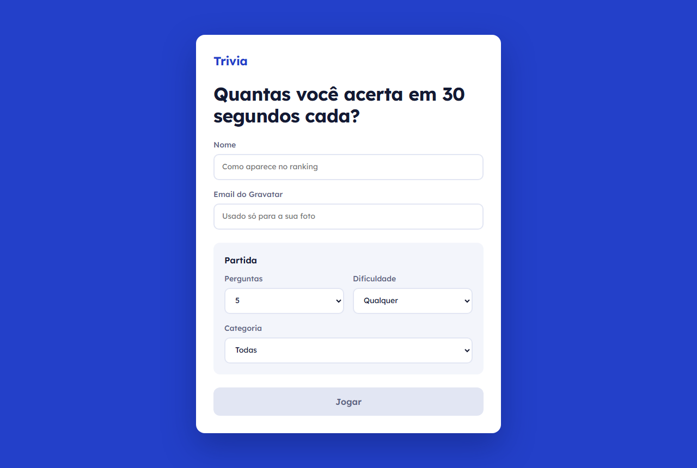
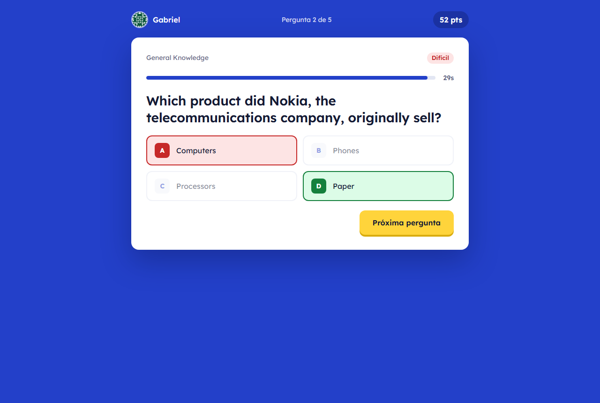

# Trivia

A timed quiz game: answer each question before the 30-second clock runs out, score more points for harder questions and faster answers, and compare results on a ranking.

**Live demo:** https://gabrielncorreia.github.io/trivia/

| Start screen | Answering a question |
| --- | --- |
|  |  |


## Features

- Choose the number of questions, the difficulty and the category before playing
- 30-second timer per question, with the right and wrong answers highlighted afterwards
- Score based on difficulty and time left
- Results screen and a ranking sorted by score, saved in the browser
- Player avatar from [Gravatar](https://gravatar.com/)

## Stack

React, Redux with Redux Thunk, React Router, and the [Open Trivia Database](https://opentdb.com/) API.

## About the project

Built as a group project at [Trybe](https://www.betrybe.com/), working in agile sprints.

In 2026 I redesigned the interface and fixed bugs: the timer sped up on every new question, the settings page did nothing, the ranking showed no names and was not sorted, and the results screen had a broken avatar. I also handled changes in the trivia API: its rate limit, expired session tokens and HTML-encoded question text.

## Running locally

Requires Node.js. From the project folder:

```sh
npm install
npm start
```

The app opens at http://localhost:3000.
