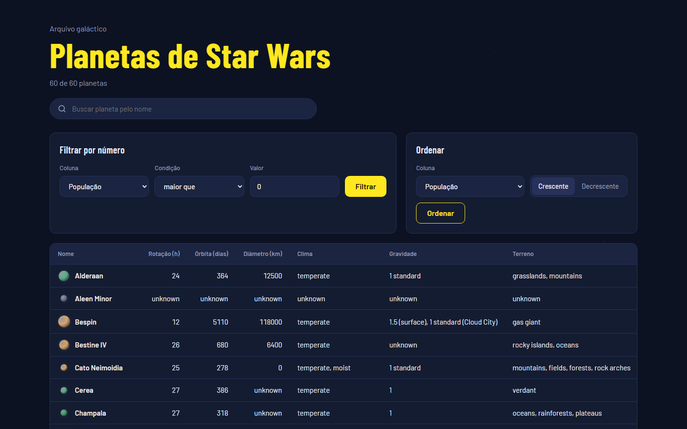
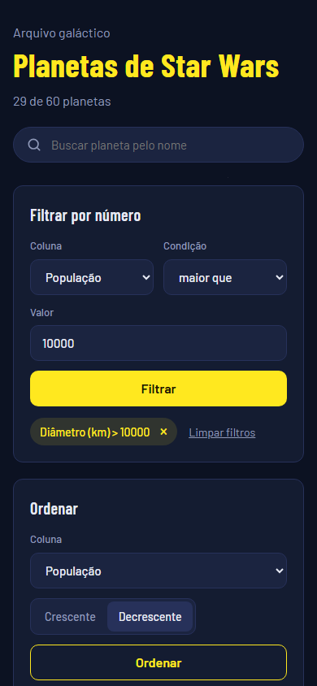

# Star Wars Planets

A searchable, filterable and sortable table of every planet in the Star Wars films.

**Live demo:** https://gabrielncorreia.github.io/starwars-planets/





## Features

- Search planets by name as you type
- Numeric filters on population, orbital period, diameter, rotation period and surface water, with "greater than", "less than" and "equal to"; filters stack, each column can be filtered once, and each filter can be removed on its own
- Sort by any numeric column, ascending or descending; planets with unknown values always go last
- A colored swatch for each planet, tinted by its climate and terrain and sized by its diameter
- Planet column that stays in place while the table scrolls sideways on small screens

## Stack

React with Hooks and the Context API, and the [SWAPI](https://swapi.info/) Star Wars API.

## About the project

Built individually at [Trybe](https://www.betrybe.com/). The 24 tests in `src/App.test.js` cover loading, the name search, the numeric filters, removing filters and sorting.

The API used during the course is no longer online, so in 2026 I moved the app to [swapi.info](https://swapi.info/), which serves the same planet data. I also redesigned the interface and finished the two features that never worked: removing a filter and sorting.

## Running locally

Requires Node.js. From the project folder:

```sh
npm install
npm start     # app at http://localhost:3000
npm test      # run the test suite
```
