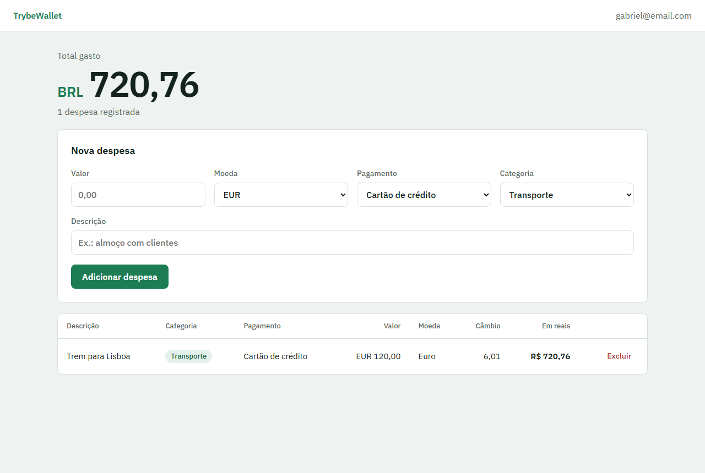
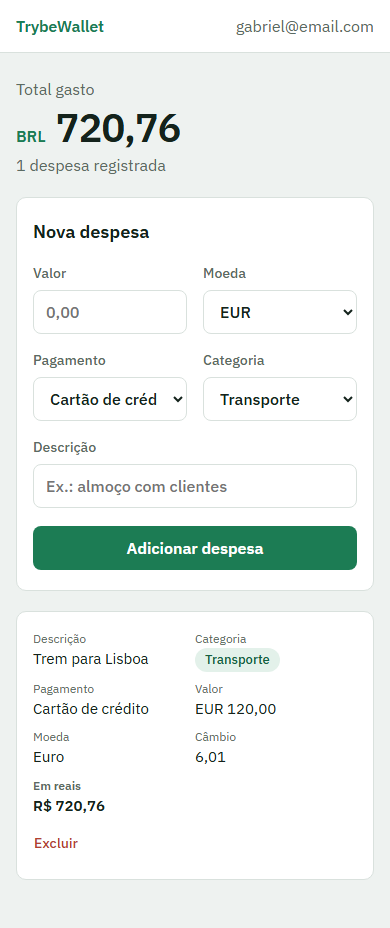

# TrybeWallet

An expense tracker for spending in several currencies: log each expense in dollars, euros, bitcoin or another currency, and see everything converted to Brazilian reais at the current exchange rate.

**Live demo:** https://gabrielncorreia.github.io/trybewallet/ (any email and a password of 6 or more characters logs you in; nothing is sent anywhere)





## Features

- Add expenses with an amount, currency, payment method, category and description
- Exchange rate fetched when each expense is saved, so its value in reais stays fixed afterwards
- Running total in reais
- Delete expenses
- Expense table that turns into cards on small screens

## Stack

React, Redux with Redux Thunk, React Router, and the [AwesomeAPI](https://docs.awesomeapi.com.br/api-de-moedas) currency API.

## About the project

Built individually at [Trybe](https://www.betrybe.com/).

In 2026 I redesigned the interface, added expense deletion, and fixed blank currency names and repeated expense IDs.

## Running locally

Requires Node.js. From the project folder:

```sh
npm install
npm start
```

The app opens at http://localhost:3000.
