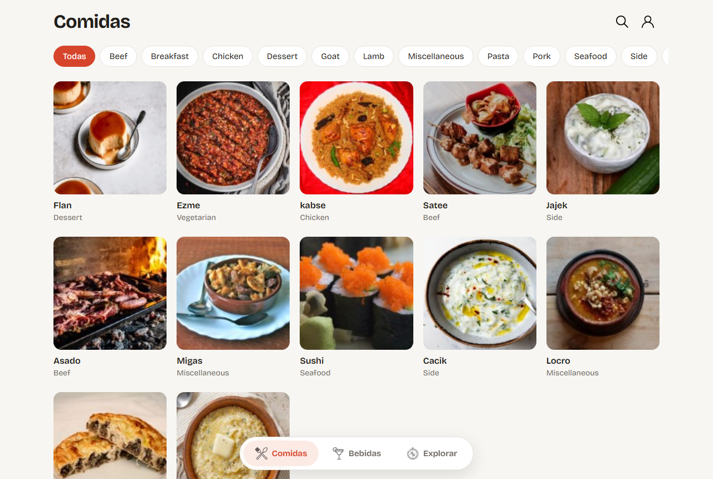
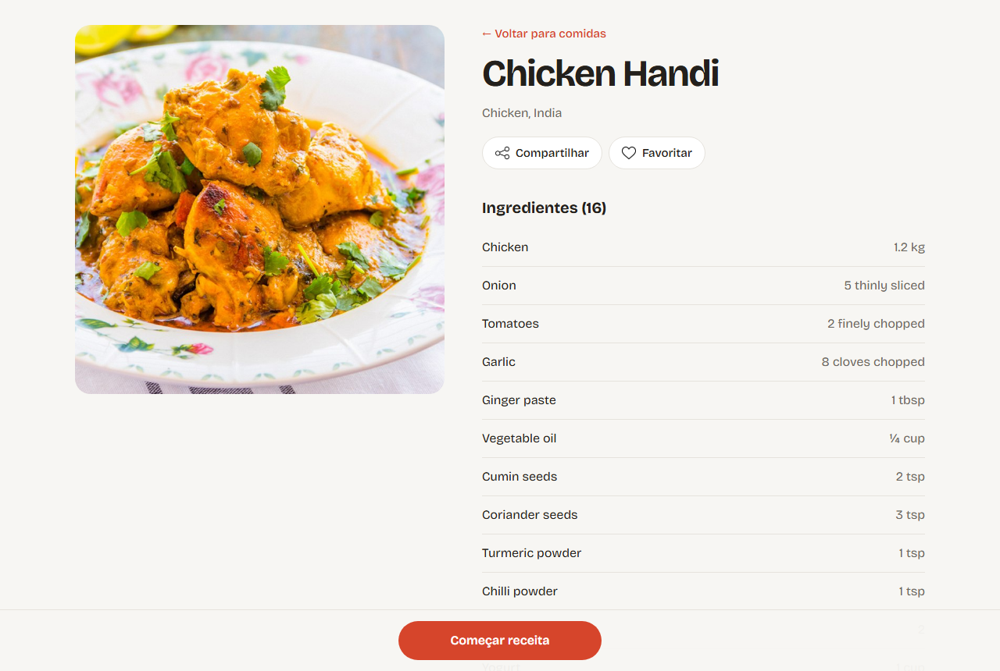
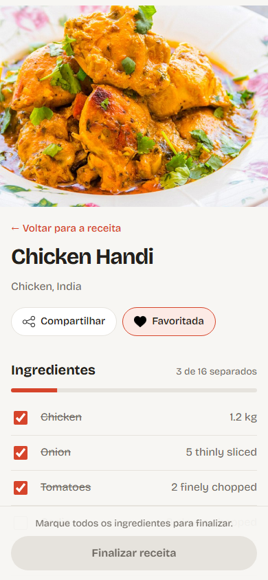

# Recipes App

A recipes app for food and drinks: browse and search recipes, follow a step-by-step cooking mode, and keep track of favorites and recipes you have made.

**Live demo:** https://gabrielncorreia.github.io/recipe-app/ (any email and a password of 7 or more characters logs you in; nothing is sent anywhere)



| Recipe page | Cooking mode on a phone |
| --- | --- |
|  |  |

## Features

- Separate sections for food and drinks, each with category filters
- Search by name, ingredient or first letter
- Recipe page with ingredients, instructions, the YouTube video and drink or food pairings
- Cooking mode with an ingredient checklist and progress bar; the recipe can only be finished once everything is checked
- Favorites and done recipes, filterable by food or drink, with copyable share links
- Explore by ingredient, by cuisine, or with a random recipe
- Progress, favorites and done recipes are saved in the browser (localStorage)

## Stack

React (Hooks and Context API), React Router, and two public APIs: [TheMealDB](https://www.themealdb.com/api.php) and [TheCocktailDB](https://www.thecocktaildb.com/api.php).

## About the project

Built as a group project at [Trybe](https://www.betrybe.com/), working in agile sprints, by the TestBreakers team.

In 2026 I redesigned the interface and fixed bugs that had appeared since: the drinks page crashed after a change in TheCocktailDB's responses, the favorites page showed done recipes and sample data, the share and favorite buttons on the recipe page did nothing, the video never played, and share links pointed to `localhost`.

## Running locally

Requires Node.js. From the project folder:

```sh
npm install
npm start
```

The app opens at http://localhost:3000.
